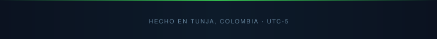

  

  
  
  

  
  
  

> **Ingeniero de Sistemas y Computación (UPTC, Tunja) — Desarrollo Full-Stack.** Construyo aplicaciones SaaS y de comercio electrónico en producción, con énfasis en arquitectura mantenible, despliegue continuo y experiencia de usuario.

---

## Sobre mí

Soy **Alex Duvan Hernández Buitrago**, estudiante de último semestre de **Ingeniería de Sistemas y Computación en la UPTC (Tunja, Colombia)** y desarrollador **Full-Stack**.

- Experiencia en producción con **React / Next.js** en frontend y **FastAPI / Node.js, Medusa, PostgreSQL** en backend.
- Despliegues reales con **Docker, Dokploy, Traefik y Cloudflare R2** en VPS.
- Práctica de ingeniería: código modular, validación de datos, control de versiones y documentación.
- Disponibilidad para trabajo **remoto** desde Tunja, Colombia (UTC-5).

---

## Competencias técnicas

<table>
  <tr>
    <td width="50%" valign="top">
      <b>FRONTEND</b> 
      
    </td>
    <td width="50%" valign="top">
      <b>BACKEND Y DATOS</b> 
      
    </td>
  </tr>
  <tr>
    <td width="50%" valign="top">
      <b>DEVOPS Y NUBE</b> 
      
    </td>
    <td width="50%" valign="top">
      <b>PRÁCTICAS DE INGENIERÍA</b> 
      
      
      
      
    </td>
  </tr>
</table>

---

## Proyectos destacados

<table>
  <tr>
    <td width="50%" valign="top">
      <h3>Comercial DEKO</h3>
      Comercio electrónico en producción
      
Tienda para ferretería e iluminación en Tunja. Catálogo con variantes, gestión de marcas y cotización por WhatsApp. Despliegue propio en VPS con HTTPS y caché de medios.

      <code>Medusa</code> <code>Next.js</code> <code>PostgreSQL</code> <code>Redis</code> <code>Stripe</code> <code>Dokploy</code>
      
<a href="https://comercialdeko.com"><b>Sitio en producción →</b></a>

    </td>
    <td width="50%" valign="top">
      <h3>ServiPerfiles A&amp;C</h3>
      Sistema de gestión (SaaS)
      
Aplicación de gestión empresarial con roles (<i>Super Admin / Manager / Supervisor / Employee</i>), autenticación y arquitectura modular por dominios. Repositorio privado por acuerdo con el cliente; demostración disponible a solicitud.

      <code>React 19</code> <code>Vite</code> <code>TypeScript</code> <code>Tailwind CSS</code> <code>Firebase</code> <code>Bun</code>
      
<a href="https://aserturik.github.io"><b>Ver en el portafolio →</b></a>

    </td>
  </tr>
  <tr>
    <td colspan="2" valign="top">
      <h3>sadScript</h3>
      Lenguaje de programación y documentación
      
Lenguaje experimental con analizador léxico y sintáctico propio. Énfasis en mensajes de error claros y documentación navegable.

      <code>TypeScript</code> <code>Astro</code> <code>Starlight</code> <code>MDX</code>
      
<a href="https://github.com/Aserturik/sadScript"><b>Código →</b></a> · <a href="https://github.com/Aserturik/sadScript-docs"><b>Documentación →</b></a>

    </td>
  </tr>
</table>

---

## Formación

- **Ingeniería de Sistemas y Computación — UPTC, Tunja.** Estudiante de último semestre.

---

## Actividad en GitHub

<table>
  <tr>
    <td width="61%" align="center">
      
    </td>
    <td width="39%" align="center">
      
    </td>
  </tr>
</table>

  <a href="https://github.com/Aserturik">
    <picture>
      <source media="(prefers-color-scheme: dark)" srcset="https://raw.githubusercontent.com/Aserturik/Aserturik/output/github-contribution-grid-snake-dark.svg" />
      <source media="(prefers-color-scheme: light)" srcset="https://raw.githubusercontent.com/Aserturik/Aserturik/output/github-contribution-grid-snake.svg" />
      
    </picture>
  </a>

  
  

---

## Contacto

- **Email:** [adhbach23@gmail.com](mailto:adhbach23@gmail.com)
- **LinkedIn:** [linkedin.com/in/aserturik](https://linkedin.com/in/aserturik)
- **Portafolio:** [aserturik.github.io](https://aserturik.github.io)
- **GitHub:** [github.com/Aserturik](https://github.com/Aserturik)
- **Ubicación:** Tunja, Boyacá, Colombia — UTC-5. Disponibilidad remota.

> Para propuestas de empleo, el contacto por email es la vía preferente.

  

